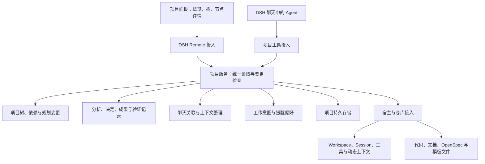

# 项目开发管理架构草案

日期：2026-11-11。状态：第一版设计基线，尚无实现与运行验证。用户授权先形成完整架构，通过实际使用优化；下述默认方式是设计选择，不代表每一条已被用户确认或证明有效。

需求与历史边界见[产品设计草案](../product/2026-11-11-project-management-design.md)，DSH 接口依据见[接入调研](../research/2026-11-11-dsh-project-management-review.md)。

## 1. 目标与设计取舍

主要服务长期代码开发：从需求调研、竞品对照和立项，到既有代码分析、功能实现、验证、发布准备，再进入下一轮。偶发的视频或其他工作可以加入同一项目。

第一版重点解决三件事：用户不用在每个聊天里重新解释项目；讨论、代码事实与规划能对应起来；项目变化不会悄悄改变正在执行的目标。既有 DSH 负责模型、会话、工具执行与宿主能力，插件负责长期项目记录及业务规则。

项目界面与功能集成在 DSH 软件内部，这是用户明确的产品要求。先采用一个 Host 项目服务和一个 DSH 内部项目面板：Host 服务是在 DSH 宿主进程中运行的插件业务逻辑，面板通过 DSH 的导航与布局扩展点呈现；不另开网站、独立应用或要求用户单独部署后端。

普通 DSH Agent 即可调用服务完成分析、规划和开发。项目服务按请求运行，不建立常驻规划 Agent、后台自动派工循环或另一套会话系统。后续官方协调能力通过同一服务接入。

## 2. 总体结构

图中的模块是同一插件内的职责划分，不要求分别部署成服务。UI 与 Agent 经不同入口调用相同的业务方法，不能各自绕过修订、依赖或授权检查。

| 模块 | 负责 | 首版边界 |
|---|---|---|
| 项目与规划 | 项目身份、目标、节点树、依赖、修订与变更记录 | 先提供可靠的增删改移及批量调整，不做独立自动调度器 |
| 分析与成果 | 分析范围、发现、来源、建议、决定、成果和验证证据 | Agent 执行分析，服务保存并核对结构化结果 |
| 上下文 | 项目与聊天关联、当前请求的目标、接续摘要与来源 | 按需提供相关内容，不向所有聊天广播全部历史 |
| 工作流与偏好 | 探索／分析／实施意图、SDD 提醒开关和项目工作约定 | 统一解释设置，不另造通用工作流引擎 |
| 宿主与工件接入 | Session、Workspace、OpenSpec、文件骨架等外部对象 | 接口先以已核查的 DSH 版本为候选，实际加载仍需验证 |
| 持久存储 | 校验、修订冲突、幂等、写入和重启恢复 | 初期候选为 DSH storageDomain，不先引入额外数据库 |

## 3. 数据归属与最小领域记录

| 记录 | 核心内容 | 权威来源与规则 |
|---|---|---|
| Project | 稳定 id、目标、约束、工作目录关联、修订号 | 插件负责逻辑项目身份，不用路径或会话 id 代替 |
| WorkNode | 稳定 id、parent、顺序、目标、完成条件、工作状态 | 插件负责树归属；依赖是独立关系，不充当父子结构 |
| ConversationLink | Session 与节点集合、关联用途、来源片段 | 多对多；关联聊天不自动授予修改所有节点的权限 |
| WorkRun | 一次工作的 Session、目标节点集合、意图、输入修订、结果 | 绑定启动时目标；轮次结束不自动完成节点 |
| Analysis | 范围、基线、覆盖情况、发现、来源、建议与关联聊天 | 区分事实、推断、建议、未核查项；分析不是产品决定 |
| Decision / Finding | 明确决定或观察结果、来源、适用范围、替代关系 | 保存来源消息或文件版本，摘要不能自行变成用户确认 |
| ArtifactRef | 代码、报告、spec、change、任务项等引用和观察版本 | 正文留在所属仓库或宿主；插件保存引用和可重建的索引 |
| Verification / Outcome | 验证对象与版本、实际检查、结果、成果和验收状态 | `pass / fail / blocked / untested` 与用户验收分别记录 |
| PlanChange / Operation | 变更依据、预期修订、实际修改、原因和执行进度 | 规划修改保留历史；跨文件动作记录实际完成项 |
| Preferences | SDD 提醒选择及明确的项目工作约定 | 偏好供 UI 和 Agent 共用，用户关闭提醒后保持关闭 |

这些是逻辑记录，可以先保存在一个项目聚合中，不等于要建十张表或提供十个独立服务。schema 和迁移从首版明确版本；字段随实践精简。

第一版一个项目可记录多个工作目录引用，但一次执行必须明确一个实际工作目录及关联的 Workspace。先验证单目录开发，不先承诺跨仓库批量执行。Workspace 被移除或重建时，把旧关联标为待核对，不靠同名路径自动接续。

Project 可以在尚无代码目录时建立，先承载立项讨论与调研。只有需要文件工作时才准备目录和 Workspace，不因宿主创建 Workspace 要求目录存在而阻止早期规划。

聊天完整历史由 DSH 管理，spec／change 正文由仓库管理，插件管理长期规划和它们之间的关系。同一份 OpenSpec tasks 的完成状态从工件读取；树中展示对应投影，不维护一份需要用户双向勾选的独立任务副本。

## 4. 从零立项与持续项目分析

### 从零立项

建议先以项目讨论聊天接收用户想法，再按目标组织需求调研、竞品对照、技术可行性与范围收敛。阶段可以交叉与反复，用户也可已有结论直接进入设计或实现。

调研输出至少能回答：目标用户与问题、现有替代方案及差别、可用技术条件、关键不确定性、首个可交付范围。竞品结论记录来源、获取日期和比较条件；无法联网或资料不足就标为未核查，不编造对照。调研开销与项目规模匹配，不为个人小工具预设大型商业分析。

Agent 据此生成初始项目树、建议的近期目标和可选骨架。创建规划、实际创建目录文件、采用某个技术方案分别记录；讨论一个方案不等于已经采用或开始实现。

### 项目分析

项目面板提供“项目分析”入口，发起专门的分析聊天。每次分析创建自己的 Analysis 与 WorkRun，Session 关联到项目整体或选定节点。需验证 DSH 的新建／空会话复用行为，记录实际返回的 id；不能误复用已有执行聊天，也不把同一项目永久绑定到一个分析会话。

已有项目首次接入、阶段进行中、里程碑完成或用户感到方向不清时，都可主动发起分析。范围可为整个项目或选中功能；默认先做有边界的静态阅读，测试、安装依赖或修改代码按明确请求与项目约定进行，不把有副作用的验证藏进“只读分析”。

分析输入包括目标与已有决定、相关代码与文档、活动 change、已知验证结果、当前树和用户关心的问题。先读入口与索引，再读取相关模块；尊重文件访问范围与项目排除规则，不默认扫描所有大文件、私密配置、生成物和完整聊天。

分析输出采用固定结构：

1. 项目现状与已观察事实。
2. 覆盖了哪些材料、尚未核查什么。
3. 目标、规范、代码和现有规划之间的差距。
4. 建议保留、补充、拆分、重排或取消的工作，以及理由。
5. 可直接应用的规划调整和需要用户决定的少量问题。

Analysis 记录观察时的规划修订和相关工件版本。分析期间项目仍可开发；应用建议前重新核对受影响部分，过时建议不能覆盖新工作。分析完成只提交发现和建议，在用户请求或已有授权范围内应用规划；不能因执行了“分析”就自动重构代码或改变已确认目标。

初期分析由用户主动触发，或由 Agent 建议入口，不默认在后台持续运行。没有新信息时不反复发起分析和重排，避免循环消耗。

## 5. 默认项目树与执行颗粒度

默认结构为：项目 → 里程碑或版本目标 → 功能／问题 → 必要的子工作。调研和技术验证也可成为节点；探索项目不必预设版本号，简单项目可以省略中间层。节点模型不硬编码固定深度或只允许某类父子搭配。

远期只保留目标与关键依赖；近期工作细化到可以说明输入、产出和完成依据的程度。Agent 的临时执行步骤继续用宿主 Todo，不把每一步文件读取都变成项目节点。工作拆分和重排优先合并提交，避免树随每条消息抖动。

节点工作状态建议采用“待办、进行中、受阻、已完成、已取消”；存在结果但仍需检查时，在节点显示验证和待处理事项，不把用户验收硬塞进每项任务的必经状态。完成条件依据项目约定判断，明确要求人工验收时才等待该条件。子节点全部完成仅提供线索，父节点仍核对自己的目标。

取消、替代与合并保留原 id 和历史，依赖环及错误树移动由程序拒绝。小修复可以一次工作直接完成节点，不要求先创建下级任务。

### 用户搭建与拼接

项目面板包含可直接编辑的树。首版先用树形拖放、插入位置和节点详情编辑实现“搭积木”的体验；不把无限画布或另一套流程引擎作为前置要求。操作菜单和键盘提供同等能力。

| 操作 | 提交语义 |
|---|---|
| 修改阶段 | 按节点 id 更新名称、目标、完成条件等；影响当前执行时另记目标修订 |
| 拖动／缩进／移出 | 整棵子树移动，保留 id、成果、聊天与历史；检查父子循环，保持显式依赖 |
| 插入流程块 | 按选定模板版本实例化子树，生成新 id，原子提交规划结构；文件骨架另走文件操作协议 |
| 多选成组／拆分／合并 | 生成可预览的批量规划变更，明确节点、依赖和引用映射；被替代节点的历史仍可查询 |
| 复制／存为模板 | 默认复制目标、条件和结构，不复制执行／完成状态、授权与私密来源；内部依赖映射至新 id，外部依赖显式核对 |
| 撤销／重做 | 以新的修订提交选定编辑的逆向／再次变更，检查当前状态；不撤销代码、外部副作用或其他人的后续修改 |

用户与 Agent 操作共用第 9 节的提交协议，记录来源、原因和受影响节点。拖放可以先本地预览，持久化后才显示已保存；修订冲突时保留编辑意图并展示变化，不静默覆盖双方修改。Agent 获取最新手工规划后再继续，不能仅因模板或旧计划不同就自动恢复原结构。

展示顺序与执行依赖分别管理。把 B 拖到 A 前面不会偷偷删除“B 依赖 A”；要改变依赖时提供明确操作，依赖成环则拒绝该提交。修改运行中目标、取消正在执行的节点或移除必要依赖时展示具体影响，调用既有工作接续规则；单纯重排不停止工作。撤销检查按受影响字段／节点核对，无法安全反向应用时给出可处理的冲突，不回滚整个项目快照。

## 6. 聊天、意图和接续

### 默认交互

项目面板在 DSH 侧边导航中提供“项目”入口，在软件内显示概览、树与节点详情。主要动作是“讨论／继续工作”“项目分析”“查看成果”。默认打开最近相关聊天，也可新建；项目整体讨论、分析与具体执行在导航中可辨认，但用户无需维护固定数量的聊天。

首版候选布局为：进入“项目”后在面板内浏览项目树和节点详情；点击相关聊天时通过 DSH 自身导航打开会话，回到项目后保留浏览位置。树与聊天同屏是后续候选体验，须核查布局 slot、Session reference 与编辑生命周期后再承诺。DSH 内部切换面板不等于打开外部网页。

聊天关联描述“谈过哪些节点”，当前请求另行绑定“本次准备为哪些节点做什么”。界面选中节点只改变浏览位置。正在实现 A 时点击 B，不改变 A 的执行目标；一次工作也可以明确覆盖 A 与 B。

### 探索、分析与实施

以用户表达和既有授权推断本次意图，提供简短可修改的“当前工作：讨论登录方案／分析认证模块／实现登录”说明。探索可阅读资料和形成草案；实施允许在约定范围内产生项目变更。用户说“按这个做”“直接实现”即可进入实施，无需额外走一次固定审批。

模糊时先推进独立的阅读与分析；只有准备采取依赖用户意图的操作时再作一次简短澄清。不要把猜测的想法写成已确认需求，也不要把选了某个节点当成实施指令。边界通过真实使用调整，保留用户修正意图的入口及原因记录。

### 换聊天时的上下文

新聊天按当前任务获得一份有来源的上下文：

- 项目目标、适用约束与明确决定。
- 当前节点及必要上级目标、直接依赖和输入。
- 相关 spec／change、文件引用和工作基线。
- 最近成果、实际验证、未解决问题和下一步。
- 当前意图、执行范围、SDD 提醒偏好及必要授权说明。

上下文按预算组织，先保留约束和当前任务，再提供必要摘要与原文入口，完整历史按需读取。摘要保留“用户确认／Agent 建议／未核查”的区别，来源失效则显式标注。重要约束无法装入时分解工作或取回原文，不静默截掉后继续实施。

当前工作获得相关新信息时生成待核对更新，在下一次请求边界刷新。已经开始的执行保持原绑定；需要改变目标则显式记录目标修订或停止／接续，不能声称已经中止的进程一定停稳。其他聊天的阶段性成果经服务归并，不要求它们彼此实时同步全量消息。

## 7. 自主规划、插单与完成

Agent 可在已授权目标内补充任务、拆分节点和调整依赖，保存原因并合并展示。不把节点大小直接当成授权标准。扩大交付范围、推翻明确目标或涉及新的外部动作时，集中提出具体选择；既有授权继续有效。

开发中发现问题时，先判断它是当前功能的必要步骤、独立待办还是阻塞原因。用户明确要求临时修复时，可记录并切换；保留原工作的接续信息。暂停请求与宿主确认停止分别记录，旧工作未确认停止时，不向同一文件范围启动冲突工作。

首版优先让用户顺序推进工作。若宿主中已有多个执行者，记录范围、基线与已知重叠，不把提示或插件内协调描述成跨进程文件写锁。自动并行派工留待后续验证。

每次结束记录代码或其他成果、实际验证、遗留问题和后续建议。执行结束、工具成功、tasks 勾选、spec 格式校验成功和功能达成是不同事实。证据关联到实际检查的对象和版本；后续相关修改会使旧验证待复核，不沿用为当前通过。

项目概览突出“当前目标、最近变化、阻塞、需你决定、建议下一步”。普通规划调整和成功验证合并进阶段性更新，真正需要用户输入时再打断。下一步的推荐不自动启动新的未授权工作。

## 8. OpenSpec、模板与偏好

OpenSpec 是首个候选 SDD 接入。读取现有项目配置与实际可用的版本，识别活动 change、spec 与 tasks，再建立工件引用。具体命令和流程来自所用版本及项目约定，不预设所有项目都是固定五步或同一 schema。

项目功能和 change 多对多关联，tasks 可以投影为节点中的执行清单。手工修改文件、归档或移走 change 后重新核对；引用失效标记为待处理，不靠文件名相似自动认领。初期优先在用户打开节点、准备工作、提交结果时刷新相关工件，不先建设全仓监听服务。

SDD 提醒具备开关，关闭后不主动催促，也不因复杂度或 OpenSpec 目录存在而自动重开；用户仍可主动使用该流程。建议个人默认加项目覆盖，默认值和作用范围仍待决定。已存在的仓库要求继续按其约定执行。提醒关闭和跳过一次是不同选择。

流程模板产生树结构，文件骨架产生目录与初始文件，两者以版本和来源关联。模板可在任意阶段应用；提炼已有项目时筛选私密内容并参数化。应用前检查冲突，结构变更批量提交；文件操作单独记录计划与进度，中断后核对实际事实，不自动重复覆盖。

## 9. 变更协议与恢复

建议初期按 Project 聚合串行提交：请求携带操作 id、预期项目修订、目标和具体改动。单个 Host 服务内统一检查身份、树与依赖约束、适用授权和幂等，再通过存储层发布新修订及变更记录。写入失败不能让 UI 显示成功。

同一操作重试不重复创建节点；已有修订变化时返回冲突及受影响内容，由调用者读取最新状态后重新生成操作，不静默覆盖。这个选择优先保证简单正确；实际频繁出现无关更新冲突后，再考虑节点级修订，而不是首版即引入复杂合并算法。

storageDomain 的写入排队不自动提供“先检查再写”的应用事务，整个检查与提交必须在同一服务提交序列内完成。以上先限定一个 Host 实例负责一个项目存储；多 Host 同时访问同一数据根未经验证，不承诺支持。

项目记录与外部文件操作无法假定原子提交。涉及骨架或工件生成时先持久化 Operation，记录待执行、已写入、已核对和未知项，再发布实际结果；重启核对文件事实，发现人工后续修改时保留冲突。分析结果与规划提交也分开，结果可以保存而规划应用失败。

保存必要的结构化变更历史即可，不引入消息总线、全量事件溯源或复制一份宿主聊天。具体持久格式、容量、清理和迁移策略留给最小实验决定。

## 10. 与 DSH 的接口及限制

| 接入 | 候选用途 | 必须验证的事项 |
|---|---|---|
| main slot 与 sidebar | 项目面板与导航 | 独立包加载、面板状态、卸载清理 |
| Host Remote 与 Client contribution | UI 调用项目服务 | 生成、挂载及重连，不能假设自动发现第三方方法 |
| tools 与动态上下文 | Agent 读写项目、获得当前工作材料 | 实际 Session 身份、请求上下文刷新和工具参数校验 |
| Session Controller／uiWorkspace | 专门分析聊天、继续执行或准备草稿 | 实际会话 id、新建与空白复用、取消及未知终态 |
| storageDomain | 项目记录持久化 | schema 迁移、失败语义、重启和串行提交 |
| Workspace 与文件服务 | 工作目录及工件访问 | 路径生命周期、访问范围、symlink 和并发变更 |

Host 插件代码不自动受会话沙箱保护。工具入口取得的执行身份和工作范围必须由接入层提供，不能信任模型自己填写的授权。插件保持纯 Node ESM、跨平台，不恢复旧自研沙箱；文件变更依照宿主可用能力和明确策略验证，不能宣称已消除所有路径竞态或外部写入。

未来官方 Super-agent 可读取规划、请求上下文、提交发现、调整阶段并记录执行结果。项目数据不绑定它的 Ticket、Thread 或某个 Team；在正式接口明确前不实现空的兼容框架。

## 11. 实施切片与实践反馈

这是建议的验证路线，不是已建立的 OpenSpec change。下列均为 `untested`：

| 切片 | 需要跑通的用户过程 | 关键反例 |
|---|---|---|
| A：长期项目与聊天 | 用户编辑／拖放树并拼接流程，节点开聊天，Agent 读写后 UI 可见，重启接续 | 保存失败、重复请求、过时修订、新聊天误绑、点击树改变执行目标、移动丢失关联、复制继承完成状态、撤销覆盖后续修改 |
| B：分析并调整 | 已有代码发起独立分析；保存带来源发现；应用授权内的规划建议 | 不完整扫描冒充全审计、分析期间代码变化、旧建议覆盖新规划、分析顺带改代码 |
| C：开发与 SDD | 功能讨论转实施，关联已有 OpenSpec，验证后记成果 | 提醒关闭仍催促、tasks 勾选冒充完成、文件归档后引用丢失、跳过提醒被当成跳过门禁 |
| D：从零与模板 | 调研和竞品对照形成范围，生成规划，再按需应用骨架 | 无来源竞品结论、模板泄露原项目私密内容、冲突文件覆盖、中断重试重复生成 |

每个切片都检验 Agent 能否在已有目标内自主调整规划。先把 A 和 B 做通，才能可靠承接后面的开发流程；新项目的调研聊天可先借用普通 DSH 能力，不必等模板完整实现。

实际试用优先记录：用户重复说明背景的次数、无关上下文和提醒、错误阶段关联、规划是否过细、从讨论误入实施的次数、变更冲突与恢复成本、关键决定等待时间，以及任务耗时／上下文开销。记录随工作产生，不默认采集原始私密代码或对话外发。

先用一个从零项目和一个已有代码项目走完整流程。将真实问题记入评审，再调整颗粒度、提醒策略、意图识别和上下文规则；只有出现实际瓶颈才增加后台分析、细粒度修订或其他基础设施。当前架构是可修改的起点，门禁通过仅验证文档与仓库纪律。
