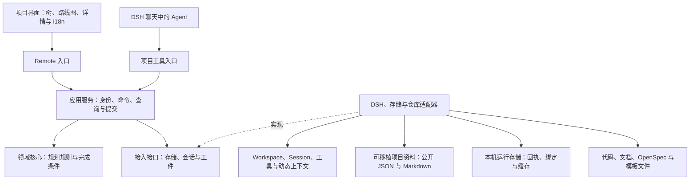

# 项目开发管理架构草案

日期：2026-11-11；修订：2026-11-12。状态：用户授权依据纸面评审修订设计，并进一步明确可选数据位置、Git 多人协作、其他 Agent 可读与新机器 DSH 接入。现行基线区分公开项目资料和本机运行数据，取代全部状态共用宿主提交头的早期设想。尚无实现与运行验证；DSH 接口、文件协议和恢复保证须实际核查。

需求与历史边界见[产品设计草案](../product/2026-11-11-project-management-design.md)，DSH 接口依据见[接入调研](../research/2026-11-11-dsh-project-management-review.md)。

数据位置、公开格式、不同 Agent 及 Git 工作副本的具体规则见[项目数据可移植与协作草案](2026-11-12-project-data-portability.md)，是本轮存储修订的专题依据。

## 1. 目标与设计取舍

主要服务长期代码开发：从需求调研、竞品对照和立项，到既有代码分析、功能实现、验证、发布准备，再进入下一轮。偶发的视频或其他工作可以加入同一项目。

第一版重点解决三件事：用户不用在每个聊天里重新解释项目；讨论、代码事实与规划能对应起来；项目变化不会悄悄改变正在执行的目标。既有 DSH 负责模型、会话、工具执行与宿主能力，插件负责长期项目记录及业务规则。

项目界面与功能集成在 DSH 软件内部，这是用户明确的产品要求。先采用一个 Host 项目服务和一个 DSH 内部项目面板：Host 服务是在 DSH 宿主进程中运行的插件业务逻辑，面板通过 DSH 的导航与布局扩展点呈现；不另开网站、独立应用或要求用户单独部署后端。

普通 DSH Agent 即可调用服务完成分析、规划和开发。项目服务按请求运行，不建立常驻规划 Agent、后台自动派工循环或另一套会话系统。后续官方协调能力通过同一服务接入。

## 2. 总体结构

图中实线表示使用或调用，虚线表示实现接口。各部分属于同一插件，不要求分别部署。UI 与 Agent 经不同入口调用相同的应用服务，不能绕过领域规则或提交检查。

### 分层与依赖方向

| 层 | 负责 | 依赖边界 |
|---|---|---|
| 领域核心 | 节点、依赖、交付条件及纯数据变换与校验 | 不导入 Cordis、React、Node 文件 API 或具体存储；不解析 OpenSpec 目录，不决定界面语言 |
| 应用服务 | 用可信调用上下文组织命令与查询，检查修订、串行提交、幂等和发布快照 | 调用领域核心及明确的存储／会话／工件接口，不把全部功能堆在一个类中 |
| 接入适配器 | DSH Remote／工具身份映射、存储、会话、Workspace、文件与 OpenSpec 解析 | 实现应用所需接口，在插件装配时注入；不另写一套规划规则 |
| 界面层 | 树、路线图、节点详情、编辑预览、i18n 和连接状态 | 消费查询快照、发送明确命令；客户端校验只作体验辅助，Host 仍重新检查 |

首版通过目录和模块落实边界，不为四层强行拆成多个 npm 包或独立进程。Host 装配层负责 Cordis 注册与生命周期；领域核心可脱离 DSH 进行业务测试。下表是这些层内部的功能职责，不代表另有七个服务。

| 模块 | 负责 | 首版边界 |
|---|---|---|
| 项目与规划 | 项目身份、目标、节点树、依赖、修订与变更记录 | 先提供可靠的增删改移及批量调整，不做独立自动调度器 |
| 分析与成果 | 分析范围、发现、来源、建议、决定、成果和验证证据 | Agent 执行分析，服务保存并核对结构化结果 |
| 上下文 | 项目与聊天关联、当前请求的目标、接续摘要与来源 | 按需提供相关内容，不向所有聊天广播全部历史 |
| 工作流与偏好 | 探索／分析／实施意图、SDD 提醒开关和项目工作约定 | 统一解释设置，不另造通用工作流引擎 |
| 界面与本地化 | 项目树、路线图及业务文案的呈现 | 用户已要求首版中英完整支持、其他宿主语言回退英文；建议复用 DSH locale，界面切换不改写项目内容 |
| 宿主与工件接入 | Session、Workspace、OpenSpec、文件骨架等外部对象 | 接口先以已核查的 DSH 版本为候选，实际加载仍需验证 |
| 持久存储 | 可移植资料读写、本机意图／回执、外部变更核对和恢复 | 三种位置使用相同公开文件协议；storageDomain 仅为本机运行数据候选，不承担跨 Git 或跨介质事务 |

## 3. 数据归属与最小领域记录

| 记录 | 核心内容 | 权威来源与规则 |
|---|---|---|
| Project | 稳定 id、目标、约束、工作目录关联、规划与状态版本 | 插件负责逻辑项目身份，不用路径或会话 id 代替 |
| WorkNode | 稳定 id、parent、顺序、目标、完成条件、工作状态、可选交付关联 | 插件负责树归属；执行依赖、交付关联与展示关系分别表达 |
| ConversationLink | Session 与节点集合、关联用途、来源片段 | 本机按 DSH 安装与资料实例区分；共享的是选定摘要与来源，不假定外部 Session 可在本机打开 |
| WorkRun | 本机实际 Session、请求／执行者映射、资料实例、目标集合、意图、输入规划指纹及本机修订、绑定与结果 | 由可信接入建立活动绑定；模型提供的 id 或恢复出的记录本身不是授权 |
| Analysis | 范围、基线、覆盖情况、发现、来源、建议与关联聊天 | 区分事实、推断、建议、未核查项；分析不是产品决定 |
| Decision / Finding | 明确决定或观察结果、来源、适用范围、替代关系 | 保存来源消息或文件版本，摘要不能自行变成用户确认 |
| ArtifactRef | 代码、报告、spec、change、任务项等引用和观察版本 | 正文留在所属仓库或宿主；插件保存引用和可重建的索引 |
| Verification / Outcome | 验证对象与版本、实际检查、结果、成果和验收状态 | `pass / fail / blocked / untested` 与用户验收分别记录 |
| PlanChange | 变更依据、前后规划指纹、实际修改、来源和原因；本机另记提交顺序 | 按共享选择发布必要摘要，不将本机修订号当作团队全局时间线 |
| CommandReceipt | 操作 id、请求摘要、调用归属、原／候选资料指纹、提交版本与生成 id | 留在原本机资料实例；先保存意图再发布公开资料，恢复协议补齐回执，不随 Git 传播运行授权 |
| Operation | 外部文件等多步动作的计划、已完成项和未知项 | 与命令回执分开；计划已保存不代表外部文件动作已完成 |
| Preferences | SDD 提醒选择及明确的项目工作约定 | 偏好供 UI 和 Agent 共用，用户关闭提醒后保持关闭 |

这些是逻辑记录，不等于要各建一张表或服务。公开资料头保存项目规划、公开引用与格式版本；本机存储保存注册、实际会话、执行绑定、意图／回执及缓存。Analysis、Decision 和 Verification 可选择发布可移植版本及来源，不能整批搬入私有聊天和运行身份。具体字段布局见数据专题；跨位置提交不再假定一个物理记录能原子容纳全部状态。

### 资料位置与工作副本身份

用户按项目选择资料放在项目目录、DSH 数据目录或自定义目录，三者使用相同的公开文本协议。其他 Agent 不启动 DSH 即可读懂资料；DSH 在另一台机器取得文件后沿用原项目和节点身份，重新建立本机 Workspace／Session／执行绑定。代码和工件以逻辑仓库及相对引用表示，本机绝对路径不进入共享数据。

本机定位按项目 id 及独立资料实例／工作副本身份区分。同项目的两个 Git 分支检出目录不共用活动绑定、快照顺序或命令回执；切换位置须显式迁移、核对后更新源代际，不双写两份权威规划。目录位置不自动决定资料必须共享或加入 Git，也不因发现新元信息静默改变用户选择。

### 版本语义

| 版本 | 何时变化 | 用途 |
|---|---|---|
| `schemaVersion` | 资料格式迁移；本机持久记录另有自身 schema 版本 | 解释数据格式，旧插件不静默重写未知格式 |
| `planVersion` | 规范化的实际规划内容变化 | 可移植规划指纹；跨 Agent／Git 环境的输入基线，不以自增整数或 Git HEAD 替代 |
| `planRevision` | 本机资料实例接受新的规划内容，包括导入、合并或回退后的不同规划 | 本机规划顺序及冲突辅助；不比较不同机器或分支的计数器 |
| `stateRevision` | 本机该实例对外发布的状态发生变化，包括规划、记录观察、执行结果、关联或新回执 | 本机完整快照排序；不作为团队全局版本 |
| 资料实例／源代际 | 切换资料源、重载执行基线或迁移 | 区分工作副本，阻止旧请求与旧响应跨源生效 |

创建或首次接入时初始化本机版本，之后本机两种修订单调递增并持久保存，重启不归零；资料源代际按打开与重载边界建立，不跨重连盲信旧值。同一快照携带可移植指纹、本机修订和资料身份。Git 回退可以恢复旧 `planVersion`，但不回退本机计数器，也不自动重放历史命令。

保存一条 Analysis 或 WorkRun 结果只推进本机 `stateRevision`，不会仅因增加过程记录就令规划过期；公开记录索引变化须保留最新资料而不改变未修改的规划。修改已有记录核对其观察版本或当前内容，不能用旧整包快照覆盖其他人新增的记录。只有指纹匹配也不足以构成执行授权。

过程记录不隐式改写节点的权威工作状态；需要标记完成、取消或重开时，通过明确规划命令核对完成条件后提交。Client 的选中节点、视图布局和语言切换属于展示状态，不推进项目规划修订；宿主语言选择不修改项目数据。命令没有实际业务变化但首次保存回执时只推进 `stateRevision`，同一已提交命令的重试不推进任一修订。

第一版一个项目可记录多个逻辑工作目录引用，但一次执行必须明确当前机器的实际工作目录及 Workspace。公开资料不携带作者的绝对路径或有效 Workspace 身份；新机器按当前检出目录重新映射。先验证单目录开发，Workspace 被移除或重建时旧本机关联待核对，不靠同名路径自动接续。

Project 可以在尚无代码目录时建立，先承载立项讨论与调研。只有需要文件工作时才准备目录和 Workspace，不因宿主创建 Workspace 要求目录存在而阻止早期规划。

聊天完整历史由 DSH 管理，spec／change 正文由仓库管理，插件管理长期规划和它们之间的关系。同一份 OpenSpec tasks 的完成状态从工件读取；树中展示对应投影，不维护一份需要用户双向勾选的独立任务副本。

## 4. 从零立项与持续项目分析

### 从零立项

建议先以项目讨论聊天接收用户想法，再按目标组织需求调研、竞品对照、技术可行性与范围收敛。阶段可以交叉与反复，用户也可已有结论直接进入设计或实现。

调研输出至少能回答：目标用户与问题、现有替代方案及差别、可用技术条件、关键不确定性、首个可交付范围。竞品结论记录来源、获取日期和比较条件；无法联网或资料不足就标为未核查，不编造对照。调研开销与项目规模匹配，不为个人小工具预设大型商业分析。

Agent 据此生成初始项目树、建议的近期目标和可选骨架。创建规划、实际创建目录文件、采用某个技术方案分别记录；讨论一个方案不等于已经采用或开始实现。

### 项目分析

项目面板提供“项目分析”入口，发起专门的分析聊天。每次分析创建自己的 Analysis 与 WorkRun，Session 关联到项目整体或选定节点。需验证 DSH 的新建／空会话复用行为，记录实际返回的 id；不能误复用已有执行聊天，也不把同一项目永久绑定到一个分析会话。

已有项目首次接入、阶段进行中、里程碑完成或用户感到方向不清时，都可主动发起分析。范围可为整个项目或选中功能；默认先做有边界的静态阅读，测试、安装依赖或修改代码按明确请求与项目约定进行，不把有副作用的验证藏进“只读分析”。

分析输入包括目标与已有决定、相关代码与文档、活动 change、已知验证结果、当前树和用户关心的问题。先读入口与索引，再读取相关模块；尊重文件访问范围与项目排除规则，不默认扫描所有大文件、私密配置、生成物和完整聊天。

分析输出采用固定结构：

1. 项目现状与已观察事实。
2. 覆盖了哪些材料、尚未核查什么。
3. 目标、规范、代码和现有规划之间的差距。
4. 建议保留、补充、拆分、重排或取消的工作，以及理由。
5. 可直接应用的规划调整和需要用户决定的少量问题。

Analysis 记录观察时的规划修订和相关工件版本。分析期间项目仍可开发；应用建议前重新核对受影响部分，过时建议不能覆盖新工作。分析完成只提交发现和建议，在用户请求或已有授权范围内应用规划；不能因执行了“分析”就自动重构代码或改变已确认目标。

初期分析由用户主动触发，或由 Agent 建议入口，不默认在后台持续运行。没有新信息时不反复发起分析和重排，避免循环消耗。

## 5. 默认项目树与执行颗粒度

默认结构为：项目 → 里程碑或版本目标 → 功能／问题 → 必要的子工作。调研和技术验证也可成为节点；探索项目不必预设版本号，简单项目可以省略中间层。节点模型不硬编码固定深度或只允许某类父子搭配。

远期只保留目标与关键依赖；近期工作细化到可以说明输入、产出和完成依据的程度。Agent 的临时执行步骤继续用宿主 Todo，不把每一步文件读取都变成项目节点。工作拆分和重排优先合并提交，避免树随每条消息抖动。

节点工作状态建议采用“待办、进行中、受阻、已完成、已取消”；存在结果但仍需检查时，在节点显示验证和待处理事项，不把用户验收硬塞进每项任务的必经状态。完成条件依据项目约定判断，明确要求人工验收时才等待该条件。子节点全部完成仅提供线索，父节点仍核对自己的目标。

### 跨分支交付里程碑

首版把里程碑表达为带自身完成条件的 WorkNode，在树中保留一个归属位置，通过交付关联引用同项目其他分支的节点或成果。例如“首版可用”可以关联“项目面板”“数据持久化”“Agent 联动”的成果，不移动或复制这些节点，也不另存一份路线图完成状态。

交付关联表达“哪些工作为此交付提供成果”，执行依赖表达“什么条件满足后才能推进”；两者不能仅因引用存在就自动互相生成。引用保留稳定身份，目标被取消、替换或引用失效时提示核对，不靠相同名称自动续接。领域层检查引用存在、同项目及非自引用；交付关联不递归推导完成。里程碑完成仍核对自己的交付条件和实际证据，不能只由引用数量或子节点完成率决定。

取消、替代与合并保留原 id 和历史，依赖环及错误树移动由程序拒绝。小修复可以一次工作直接完成节点，不要求先创建下级任务。

### 用户搭建与拼接

项目面板包含可直接编辑的树。首版先用树形拖放、插入位置和节点详情编辑实现“搭积木”的体验；不把无限画布或另一套流程引擎作为前置要求。操作菜单和键盘提供同等能力。

| 操作 | 提交语义 |
|---|---|
| 修改阶段 | 按节点 id 更新名称、目标、完成条件等；影响当前执行时另记目标修订 |
| 拖动／缩进／移出 | 整棵子树移动，保留 id、成果、聊天与历史；检查父子循环，保持显式依赖 |
| 插入流程块 | 按选定模板版本实例化子树，生成新 id，原子提交规划结构；文件骨架另走文件操作协议 |
| 多选成组／拆分／合并 | 生成可预览的批量规划变更，明确节点、依赖和引用映射；被替代节点的历史仍可查询 |
| 复制／存为模板 | 默认复制目标、条件和结构，不复制执行／完成状态、授权与私密来源；内部依赖映射至新 id，外部依赖显式核对 |
| 撤销／重做 | 以新的修订提交选定编辑的逆向／再次变更，检查当前状态；不撤销代码、外部副作用或其他人的后续修改 |

用户与 Agent 操作共用第 9 节的提交协议，记录来源、原因和受影响节点。拖放可以先本地预览，持久化后才显示已保存；修订冲突时保留编辑意图并展示变化，不静默覆盖双方修改。Agent 获取最新手工规划后再继续，不能仅因模板或旧计划不同就自动恢复原结构。

展示顺序与执行依赖分别管理。把 B 拖到 A 前面不会偷偷删除“B 依赖 A”；要改变依赖时提供明确操作，依赖成环则拒绝该提交。修改运行中目标、取消正在执行的节点或移除必要依赖时展示具体影响，调用既有工作接续规则；单纯重排不停止工作。撤销检查按受影响字段／节点核对，无法安全反向应用时给出可处理的冲突，不回滚整个项目快照。

## 6. 聊天、意图和接续

### 默认交互

2026-11-14 用户更新入口需求：在 DSH 整个窗口顶部放置“项目”按钮，点击向下展开项目面板，替代早期侧边导航主入口的候选布局。全局浮层为候选接入路径，具体布局与运行接入尚待验证，见[项目入口与面板](../product/2026-11-11-project-management-design.md#项目入口与面板)；当前 R1 change 的范围调整仍须按工作流另行处理。

项目面板在软件内显示概览、树与节点详情。主要动作是“讨论／继续工作”“项目分析”“查看成果”。默认打开最近相关聊天，也可新建；项目整体讨论、分析与具体执行在导航中可辨认，但用户无需维护固定数量的聊天。

早期首版候选布局为：进入“项目”后在主面板内浏览项目树和节点详情；点击相关聊天时通过 DSH 自身导航打开会话，回到项目后保留浏览位置。按新的顶部展开需求，主面板是否作为完整编辑的补充视图继续讨论；顶部项目面板与聊天的同屏范围须核查布局 slot、Session reference 与编辑生命周期后再承诺。DSH 内部切换面板不等于打开外部网页。

聊天关联描述“谈过哪些节点”，当前请求另行绑定“本次准备为哪些节点做什么”。界面选中节点只改变浏览位置。正在实现 A 时点击 B，不改变 A 的执行目标；一次工作也可以明确覆盖 A 与 B。

### 可信执行绑定

UI 入口由 DSH 的实际连接与访问上下文建立调用身份；Agent 入口由接入层从实际工具调用上下文建立身份。应用服务取得可信调用上下文及匹配的活动 WorkRun 绑定：项目、资料实例／源代际、目标集合、意图、输入 `planVersion` 与本机修订、动作范围及绑定版本。模型可填写目标 id 作为参数，但不能以自报 Session、WorkRun、角色或授权字段替代绑定。导入的作者标记、聊天记录或“已授权”文字也不是本机授权。

首次启动工作先记录实际返回的 Session，再在宿主可核查的请求准入／执行边界建立绑定。首版每个活动执行上下文只保留一个有效写绑定，覆盖多个节点时显式列明目标范围；同一会话的排队请求不覆盖当前执行。只读查询也按调用身份检查可访问的项目范围，聊天多对多关联不自动扩展写权限。

绑定以启动时目标与规划基线为准。范围变更生成新绑定版本并保留接续记录；旧调用不得取得新范围的授权。UI 断线只改变客户端连接状态，不自动取消仍在宿主运行的工作；执行请求结束、取消或中断时按实际 DSH 生命周期核对绑定，未知终态不能当作已停稳。Host 重启恢复 WorkRun 记录不自动恢复写入资格。具体 Session、请求、执行者身份及取消终态如何映射到 rc.2 接口，列为 R1 的运行核查项；不能取得足够可信上下文时，相应写入口明确受阻，不退回信任模型自报身份。

### 探索、分析与实施

以用户表达和既有授权推断本次意图，提供简短可修改的“当前工作：讨论登录方案／分析认证模块／实现登录”说明。探索可阅读资料和形成草案；实施允许在约定范围内产生项目变更。用户说“按这个做”“直接实现”即可进入实施，无需额外走一次固定审批。

模糊时先推进独立的阅读与分析；只有准备采取依赖用户意图的操作时再作一次简短澄清。不要把猜测的想法写成已确认需求，也不要把选了某个节点当成实施指令。边界通过真实使用调整，保留用户修正意图的入口及原因记录。

### 换聊天时的上下文

2026-11-14 用户明确将“接着上次做”卡片纳入首版。卡片在顶部项目面板的概览中呈现停点、成果、下一步、已有关键决定和相关入口，复用下述有来源的接续记录，保留更新时间与验证状态；不维护第二份任务状态。摘要缺失、来源失效或基线变化时明确标记，打开原聊天不自动发起请求或恢复旧绑定。产品范围见[首版接续卡片](../product/2026-11-11-project-management-design.md#首版接着上次做卡片)；具体选择、更新及同步在 R2 细化，R6 验收，当前无实现与运行结论。

新聊天按当前任务获得一份有来源的上下文：

- 项目目标、适用约束与明确决定。
- 当前节点及必要上级目标、直接依赖和输入。
- 相关 spec／change、文件引用和工作基线。
- 最近成果、实际验证、未解决问题和下一步。
- 当前意图、执行范围、SDD 提醒偏好及必要授权说明。

上下文按预算组织，先保留约束和当前任务，再提供必要摘要与原文入口，完整历史按需读取。摘要保留“用户确认／Agent 建议／未核查”的区别，来源失效则显式标注。重要约束无法装入时分解工作或取回原文，不静默截掉后继续实施。

当前工作获得相关新信息时生成待核对更新，在下一次请求边界刷新。已经开始的执行保持原绑定；需要改变目标则显式记录目标修订或停止／接续，不能声称已经中止的进程一定停稳。其他聊天的阶段性成果经服务归并，不要求它们彼此实时同步全量消息。

## 7. 自主规划、插单与完成

Agent 可在已授权目标内补充任务、拆分节点和调整依赖，保存原因并合并展示。不把节点大小直接当成授权标准。扩大交付范围、推翻明确目标或涉及新的外部动作时，集中提出具体选择；既有授权继续有效。

开发中发现问题时，先判断它是当前功能的必要步骤、独立待办还是阻塞原因。用户明确要求临时修复时，可记录并切换；保留原工作的接续信息。暂停请求与宿主确认停止分别记录，旧工作未确认停止时，不向同一文件范围启动冲突工作。

首版优先让用户顺序推进工作。若宿主中已有多个执行者，记录范围、基线与已知重叠，不把提示或插件内协调描述成跨进程文件写锁。自动并行派工留待后续验证。

每次结束记录代码或其他成果、实际验证、遗留问题和后续建议。执行结束、工具成功、tasks 勾选、spec 格式校验成功和功能达成是不同事实。证据关联到实际检查的对象和版本；后续相关修改会使旧验证待复核，不沿用为当前通过。

项目概览突出“当前目标、最近变化、阻塞、需你决定、建议下一步”。普通规划调整和成功验证合并进阶段性更新，真正需要用户输入时再打断。下一步的推荐不自动启动新的未授权工作。

## 8. OpenSpec、模板与偏好

OpenSpec 是首个候选 SDD 接入。读取现有项目配置与实际可用的版本，识别活动 change、spec 与 tasks，再建立工件引用。具体命令和流程来自所用版本及项目约定，不预设所有项目都是固定五步或同一 schema。

项目功能和 change 多对多关联，tasks 可以投影为节点中的执行清单。手工修改文件、归档或移走 change 后重新核对；引用失效标记为待处理，不靠文件名相似自动认领。初期优先在用户打开节点、准备工作、提交结果时刷新相关工件，不先建设全仓监听服务。

SDD 提醒具备开关，关闭后不主动催促，也不因复杂度或 OpenSpec 目录存在而自动重开；用户仍可主动使用该流程。建议个人默认加项目覆盖，默认值和作用范围仍待决定。已存在的仓库要求继续按其约定执行。提醒关闭和跳过一次是不同选择。

流程模板产生树结构，文件骨架产生目录与初始文件，两者以版本和来源关联。模板可在任意阶段应用；提炼已有项目时筛选私密内容并参数化。应用前检查冲突，结构变更批量提交；文件操作单独记录计划与进度，中断后核对实际事实，不自动重复覆盖。

## 9. 变更协议、同步与恢复

### 命令与幂等提交

按本机资料实例组织单个应用提交序列。规划命令携带项目／资料实例身份、源代际、操作 id、预期 `planVersion`、本机规划修订和明确改动；调用身份及活动绑定由接入层另行提供。纯查询不产生变更回执。运行记录或分析追加核对自身身份和资料基线，不因无关过程记录增加而要求重做规划。

提交序列内依次执行：

1. 验证可信调用身份、项目访问和请求格式；生成稳定请求摘要，包含命令类型、业务参数、输入基线及稳定调用主体与原操作归属，不包含重连或重试重新准入产生的连接／请求临时标识。原操作归属与当前有效执行绑定分别处理，重试不是重新授权。
2. 按原本机资料实例与操作 id 查询持久回执。调用者有权读取时，相同摘要与归属返回原结果；同 id 携带不同请求或归属则拒绝。存在未完成意图时进入恢复核对，不另起一次执行。**回执查询先于新命令的规划基线冲突判断。**
3. 没有原操作记录时，核对有效绑定、动作范围、当前资料实例／源代际、规划指纹、本机修订及领域规则；重新读取当前资料，过时规划或不合法资料返回冲突，不套用旧修改。
4. 构造新的不可变状态与稳定生成 id，先持久保存本机命令意图，再发布公开资料，最后完成私有回执与本机版本；具体跨介质恢复见下节。重新基于最新资料合入未变规划之外的新增记录，不将整包旧快照写回。
5. 核实资料发布与本机回执完成后发出通知，返回回执和带版本结果。任何一步结果不明时返回待核对，不能因公开文件已写入就盲目重放；通知失败也不撤回已保存资料。

例如，原实例中命令已创建节点并完成回执，但响应丢失；重试返回第一次生成的节点 id，不因当前规划已改变而误报冲突，也不重复创建。若 Git 已回退到旧分支，回执仍只是历史提交结果，不把旧操作重放到该分支。原回执表示当时提交位置，不代表最新状态；有效读取权限也不等于新的执行授权。

首版回执持久保留，不自动淘汰后把旧操作当作全新请求。后续容量与清理方案须明确可重试范围和过期拒绝语义，再允许清理。

### 可移植资料与本机恢复

公开资料头发布当前规划、共享记录引用和格式版本；本机运行存储保留意图／回执、实际会话、绑定及同步顺序。早期的“规划与回执在一个宿主记录中原子替换”已被这项公开／本机分离需求取代，不宣称跨目录或后端事务。

写入前本机意图保存原资料基线、候选内容指纹、生成 id 和调用归属；独立正文先保存，再通过公开资料头发布引用，最后完成本机回执。应用查询只读取头引用的有效记录，未引用正文不算已发布成果；其他 Agent 的阅读说明同样明确资料入口与权威引用规则。第三方编辑后重新校验，不要求其伪造本机回执。

崩溃时先核对本机意图与当前文件，只有可确定候选内容已达成时才记录核对结果并补齐回执，不能据此伪造执行过程证据。资料已分叉、回退或发布结果不明时保留待核对，不盲重放，也不因当前再次等于旧基线就断言从未提交。原完成回执可查询，但不跨其他资料实例导入执行资格。详细流程见[数据可移植草案](2026-11-12-project-data-portability.md#可移植头与私有回执的提交)。

本机存储出现 `unknown-state` 时停止受影响领域的读写；公开文件发布结果未知、Git 冲突、格式不支持或领域校验失败时，阻止对应资料源的新写入。界面保留的旧值标注未同步，恢复后先核查意图、回执和资料，不换操作 id 掩盖未知结果。

首版每个本地资料实例由一个插件写者负责。多人分别使用自己的工作副本，通过 Git 合并；同一目录内的 Git／外部 Agent 编辑与插件保存按明确的同步边界顺序进行。提交前重读不构成跨进程文件锁，不承诺任意外部并发写入或共享网络目录多写者安全。

### 查询快照与 Client 同步

应用服务从已校验的资料基线及对应本机状态构造完整查询快照，携带项目／资料实例身份、源代际、`schemaVersion`、`planVersion`、本机 `planRevision` 和 `stateRevision`。引用记录核对其观察内容，读取期间资料有变则重新读取，不将不同资料基线拼成一次权威快照。外部工件标注实际版本与新鲜度。树与两种路线图从同一快照派生，未提交编辑与布局单独保存。

首版采用完整快照与变更后回读：先建立本机资料实例的变更通知，再读取初始快照；通知提示刷新，不替代权威数据。读取期间如得知新版本则继续回读，直到覆盖已知变化。外部资料在打开、请求准备、提交与显式刷新边界重新核对；文件监听仅作提示，不能单靠宿主内存缓存或事件判断磁盘已同步。

Client 按连接代际、资料实例／源代际和本机 `stateRevision` 接受响应：旧连接、旧资料源及较旧状态不能覆盖新状态。不同机器的计数器不作大小比较，Git 回退后重新接纳资料也不回退本机顺序。旧回执不回滚界面；断线保留未提交编辑，重连重建通知并回读完整状态。资料源发生 Git 或外部变更时核对运行基线，旧绑定不自动沿用到新内容。相关映射及生命周期由 R1／R2 实测。

### 外部动作与证据

项目记录与外部文件操作不假定原子提交。骨架或工件生成先持久化 Operation，分别记录计划、待执行、已写入、已核对和未知项；保存计划的命令成功不等于外部动作完成。重启核对文件事实，发现人工后续修改时保留冲突，不无条件重放整批操作。

分析结果保存与规划应用分别提交；WorkRun 结束与节点完成分别处理。验证绑定实际受检对象与观察版本，只有 Git 提交号不足以代表包含未提交修改的工作目录。相关内容变化后旧结果保留为历史，并显示当前需要复核，不能改写旧证据或沿用为当前通过。

保存必要的结构化历史和结果即可，不引入消息总线或全量事件溯源。R1 必须把以上提交、身份和同步场景转换成实际验收；尚未执行时统一记为 `untested`。

## 10. 与 DSH 的接口及限制

| 接入 | 候选用途 | 必须验证的事项 |
|---|---|---|
| main slot 与 sidebar | 项目面板与导航 | 独立包加载、面板状态、卸载清理 |
| Host Remote 与 Client contribution | UI 调用项目服务 | 生成、挂载及重连，不能假设自动发现第三方方法 |
| tools 与动态上下文 | Agent 读写项目、获得当前工作材料 | 实际 Session 身份、请求上下文刷新和工具参数校验 |
| Session Controller／uiWorkspace | 专门分析聊天、继续执行或准备草稿 | 实际会话 id、新建与空白复用、取消及未知终态 |
| 公开文件适配器 | 三种位置的可移植资料、Git 与其他 Agent 接入 | 格式校验、资料基线、外部变化、路径语义、失败与迁移 |
| storageDomain | 本机注册、意图／回执及缓存的候选 | 路由、schema、失败及恢复；不假定可按 Project 任意指定目录或重配其他宿主领域 |
| Workspace 与文件服务 | 工作目录及工件访问 | 路径生命周期、访问范围、symlink 和并发变更 |

Host 插件代码不自动受会话沙箱保护。工具入口取得的执行身份和工作范围必须由接入层提供，不能信任模型自己填写的授权。插件保持纯 Node ESM、跨平台，不恢复旧自研沙箱；文件变更依照宿主可用能力和明确策略验证，不能宣称已消除所有路径竞态或外部写入。

未来官方 Super-agent 可读取规划、请求上下文、提交发现、调整阶段并记录执行结果。项目数据不绑定它的 Ticket、Thread 或某个 Team；在正式接口明确前不实现空的兼容框架。

## 11. 实施切片与实践反馈

2026-11-12 已将以下切片展开为[插件开发路线图草案](../engineering/2026-11-12-plugin-development-roadmap.md)，补充 R1–R6 的交付、依赖与完成标准；用户已认可[路线图功能](../product/2026-11-12-project-roadmap-design.md)共用规划、结合目标与时间视图的整体设计。首版中英范围也已明确，接入与验收见[i18n 草案](2026-11-12-plugin-i18n-design.md)；具体实现仍待验证。

下表是整体切片建议；其中 R1 已形成独立 [OpenSpec change](../../openspec/changes/establish-r1-project-plugin/proposal.md)，当前提案已完成第 1 轮外审并按意见修订，尚未实施。R1 的后端和首版格式选择见该 change，尚未实施；下列运行验证均为 `untested`：

| 切片 | 需要跑通的用户过程 | 关键反例 |
|---|---|---|
| A：长期项目与聊天 | 用户编辑／拖放树并拼接流程，节点开聊天，Agent 读写后 UI 可见，重启接续 | 保存失败、响应丢失后重试、回执半提交、过时规划、伪造或旧执行绑定、旧连接快照覆盖、新聊天误绑、点击树改变执行目标、跨分支交付引用失效、复制继承完成状态、撤销覆盖后续修改 |
| B：分析并调整 | 已有代码发起独立分析；保存带来源发现；应用授权内的规划建议 | 不完整扫描冒充全审计、分析期间代码变化、旧建议覆盖新规划、分析顺带改代码 |
| C：开发与 SDD | 功能讨论转实施，关联已有 OpenSpec，验证后记成果 | 提醒关闭仍催促、tasks 勾选冒充完成、文件归档后引用丢失、跳过提醒被当成跳过门禁 |
| D：从零与模板 | 调研和竞品对照形成范围，生成规划，再按需应用骨架 | 无来源竞品结论、模板泄露原项目私密内容、冲突文件覆盖、中断重试重复生成 |

每个切片都检验 Agent 能否在已有目标内自主调整规划。先把 A 和 B 做通，才能可靠承接后面的开发流程；新项目的调研聊天可先借用普通 DSH 能力，不必等模板完整实现。

实际试用优先记录：用户重复说明背景的次数、无关上下文和提醒、错误阶段关联、规划是否过细、从讨论误入实施的次数、变更冲突与恢复成本、关键决定等待时间，以及任务耗时／上下文开销。记录随工作产生，不默认采集原始私密代码或对话外发。

先用一个从零项目和一个已有代码项目走完整流程。将真实问题记入评审，再调整颗粒度、提醒策略、意图识别和上下文规则；只有出现实际瓶颈才增加后台分析、细粒度修订或其他基础设施。当前架构是可修改的起点，门禁通过仅验证文档与仓库纪律。
